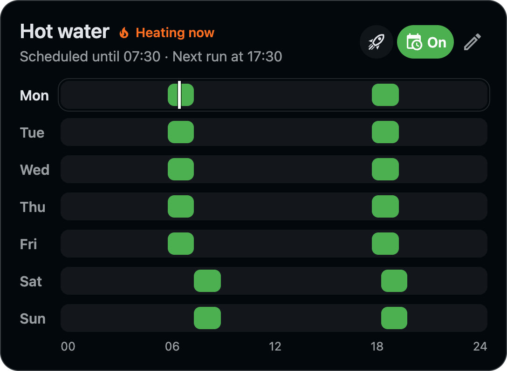
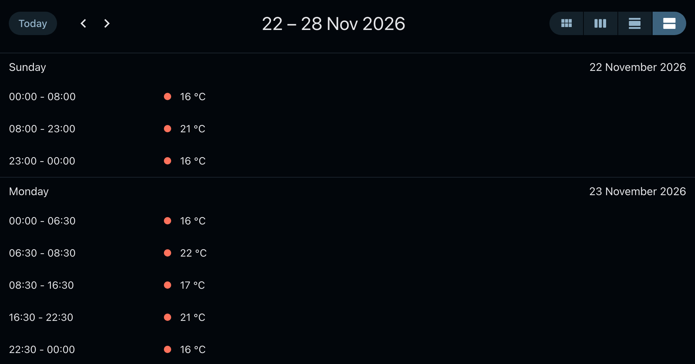
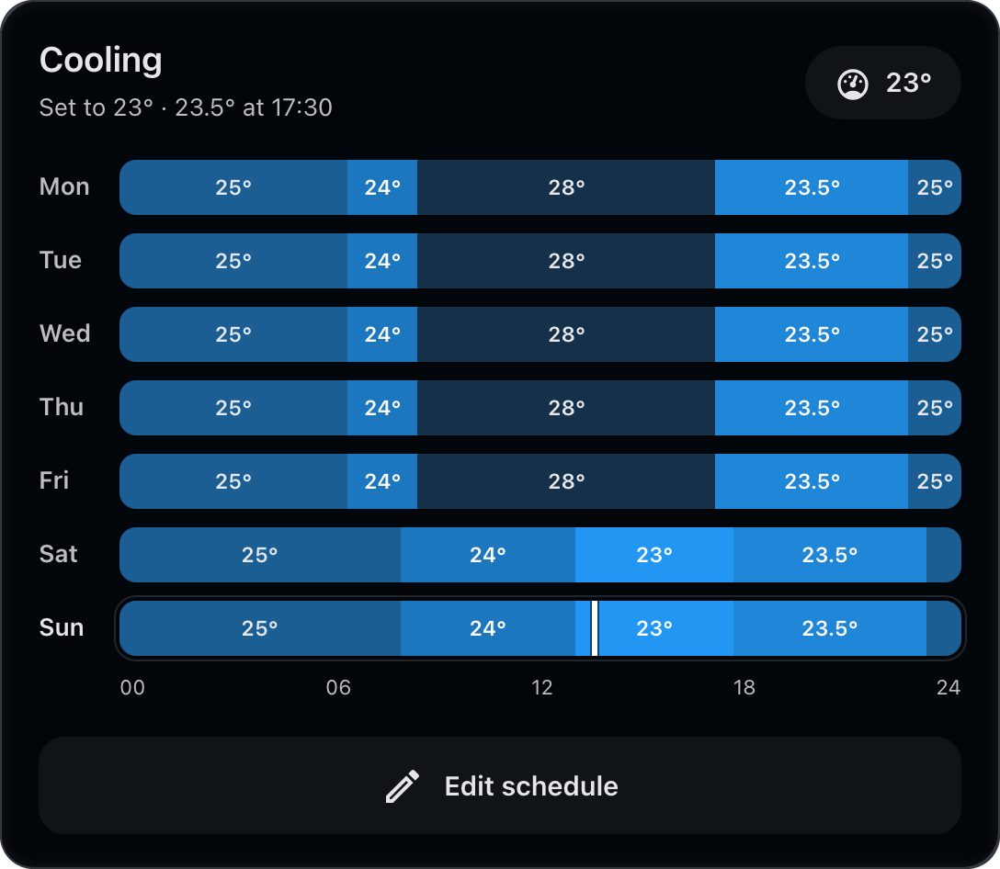
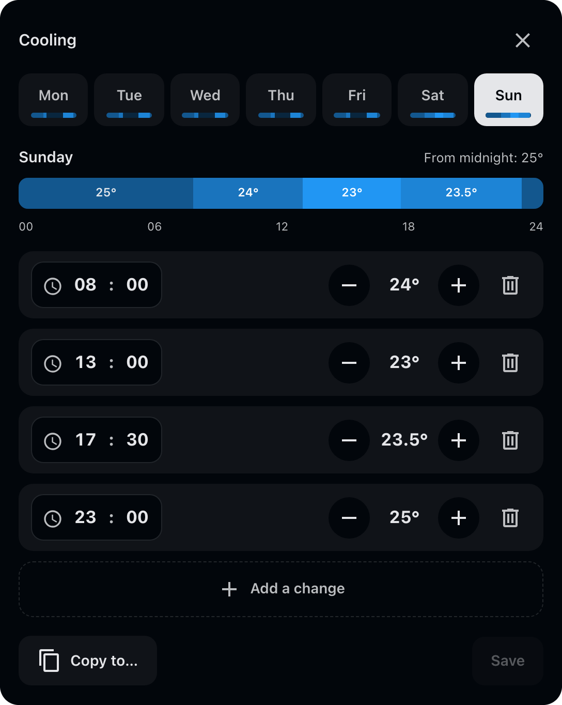

<div align="center">


# unfr0zen for Home Assistant

**Your Nest's own heating and hot water schedules, as Home Assistant calendars you can edit.**

[](https://hacs.xyz/docs/faq/custom_repositories/)
[](https://github.com/unfr0zen/homeassistant-unfr0zen/releases)
[](https://www.home-assistant.io/)
[](https://github.com/unfr0zen/homeassistant-unfr0zen/actions/workflows/validate.yml)
[](LICENSE)

[](https://my.home-assistant.io/redirect/hacs_repository/?owner=unfr0zen&repository=homeassistant-unfr0zen&category=integration)
[](https://my.home-assistant.io/redirect/config_flow_start/?domain=unfr0zen)

</div>

A Nest Learning Thermostat freed by [unfr0zen](https://github.com/unfr0zen/unfr0zen) keeps running its own weekly
schedule. This integration puts that schedule in Home Assistant, as calendars and as dashboard cards: read it, add, move
or remove a change, and the Nest takes it, over whichever way Home Assistant reaches it.

<p align="center">
  
  
</p>

## Features

- 🗓️ **Heating or cooling schedule as a calendar**, whichever the Nest runs. Each setpoint is a weekly event, from its
  time until the next one.
- 🎛️ **Dashboard cards** for the heating and the hot water: the whole week at a glance, edited a day at a time.
- ✏️ **Edit from Home Assistant.** Create, move or delete events in the calendar panel, a card or an automation; the
  Nest takes the change and the calendar follows what the unit does.
- 🚿 **Hot water schedule**, on a unit with hot water control (Heat Link), as its own calendar of on periods.
- 📡 **Every transport unfr0zen speaks:** nestlocal's MQTT topics, Zigbee2MQTT, ZHA and Matter.
- 🔍 **Found on its own** when the Nest publishes over MQTT.
- 🏠 **On the Nest's own device**, beside its climate and sensors; nothing in the cloud.

## Requirements

- Home Assistant 2026.10 or later.
- A Nest set up with [unfr0zen](https://github.com/unfr0zen/unfr0zen), at a release with schedules, reached over one of:

| Transport | Home Assistant needs | Heating | Hot water |
|-|-|:-:|:-:|
| nestlocal's MQTT topics | the MQTT integration | ✅ | ✅ |
| Zigbee2MQTT | the MQTT integration, unfr0zen's converter | ✅ | ✅ |
| ZHA | ZHA | ✅ | ✅ |
| Matter (Wi-Fi or Thread) | the Matter integration | ✅ | ✅ |

## Installation

### HACS (recommended)

1. Click **Open in HACS** above, or in HACS open the menu → **Custom repositories**, add
   `https://github.com/unfr0zen/homeassistant-unfr0zen` as an **Integration**.
2. Download **unfr0zen**, then restart Home Assistant.

### Manual

Copy `custom_components/unfr0zen` into your configuration's `custom_components/` folder and restart Home Assistant.

## Setup

Click **Add integration** above, or go to **Settings → Devices & services → Add integration → unfr0zen**, and pick how
Home Assistant reaches the Nest. A Nest on MQTT shows up under **Discovered** by itself.

<p align="center">
  
</p>

Add one entry per Nest. The calendars join the Nest's existing device.

## Using the calendars

<p align="center">
  
</p>

### Heating and cooling

The Nest keeps a schedule for each of its modes and runs the one for the mode it is in. The heating schedule calendar
and the heating card show and change that one:

| Nest mode | Its schedule | In Home Assistant |
|-|-|-|
| Heat | heating setpoints | read and changed |
| Cool | cooling setpoints | read and changed; the card says **Cooling**, in Home Assistant's cooling colour |
| Heat·Cool | a low and a high temperature at each change | read only: no events, and changes are refused |

To set cooling setpoints, switch the Nest to Cool (on the unit or its climate entity), then edit the schedule. Switch
back to Heat and the heating schedule is as you left it: each mode keeps its own. The Nest takes a few seconds to bring
up the other schedule: edit once the card says **Cooling**, as a change saved before then goes to the heating one.

<p align="center">
  
</p>

- Each setpoint is an event repeating every week on its day, from its time until the next setpoint, titled with its
  temperature, such as `20.5 °C`.
- **Add a change:** a new event that repeats weekly with no end, at the time it should start, titled with the
  temperature. It may repeat on several days; its end is ignored, as the next setpoint ends it.
- **Edit or delete** one occurrence and the whole series changes: the Nest's schedule is the same every week.
- Writing the schedule turns off the Nest's Auto-Schedule, so it doesn't learn over your changes.

### Hot water

- Each on period is an event repeating every week, from on to off; one may run past midnight.
- Add, move or delete periods as for heating; the title is ignored.
- The calendar only exists on a Nest with hot water control, and comes or goes with it.

### Limits

| | Heating or cooling | Hot water |
|-|-|-|
| Per day | 10 setpoints | 6 periods |
| Temperatures | 4.5–35 °C (9–32 °C over Zigbee and Matter), in half degrees | — |
| Refused | one-off events, other repeats, all-day events, a heat-cool (range) schedule | one-off events, other repeats, all-day events, overlapping periods |

A refused change is reported with the reason and leaves the Nest's schedule as it was.

<details>
<summary><b>How each transport carries the schedule</b></summary>

| Transport | Heating | Hot water |
|-|-|-|
| nestlocal MQTT | `<prefix>/<serial>/heating_times`, `set/heating_times` | `<prefix>/<serial>/hot_water_times`, `set/hot_water_times` |
| Zigbee2MQTT | the device's `heating_times` (Set/Get Weekly Schedule) | the device's `hot_water_times` |
| ZHA | Thermostat cluster Set/Get Weekly Schedule, one day per request | manufacturer cluster `0xFC01`, one attribute per day |
| Matter | Thermostat cluster `Schedules` (Matter 1.4), written in an atomic write | the same, on the Nest's Water Heater endpoint |

ZHA offers no action that returns a command's answer, so the ZHA backend reaches the Thermostat cluster through ZHA's
internal gateway; a Home Assistant release that changes those internals shows as an error naming the device. The full
protocol is in unfr0zen's [protocol reference](https://unfr0zen.com/protocols/).

</details>

## Dashboard cards

Two cards come with the integration, in the card picker as **unfr0zen heating** and **unfr0zen hot water**:

```yaml
type: custom:unfr0zen-heating-card
entity: calendar.nest_thermostat_heating_schedule
```

```yaml
type: custom:unfr0zen-hot-water-card
entity: calendar.nest_thermostat_hot_water_schedule
```

- **Heating** shows the week's setpoints, the one in effect and the next, and the thermostat's target. While the Nest is
  in Cool it shows the cooling schedule, titled **Cooling**; a Heat·Cool schedule is shown but can't be edited.
- **Hot water** shows the week's on periods, whether hot water is on now and when it next comes on, with its boost and
  its on/off switch.
- **Edit schedule** opens a day at a time: change, add or remove setpoints or periods, copy a day to others, and save;
  the Nest takes the days changed in one write.

<p align="center">
  
  
</p>

The cards find the Nest's climate entity, hot water switch, boost and hot water sensor on its device. Set them yourself
with `climate`, `switch`, `boost`, `active` or `water_heater` if they are elsewhere.

Automations can do what the editor does with the `unfr0zen.set_schedule` and `unfr0zen.set_hot_water_schedule` actions,
which replace the days they name:

```yaml
action: unfr0zen.set_schedule
target:
  entity_id: calendar.nest_thermostat_heating_schedule
data:
  days:
    sat: [{ time: "08:00", temp: 20.5 }, { time: "23:00", temp: 16 }]
```

## Development

```sh
uv venv -p python3.14 .venv
uv pip install -p .venv -r requirements_test.txt
.venv/bin/python -m pytest
.venv/bin/ruff format --check . && .venv/bin/ruff check .
```

## License

[GPL-3.0-or-later](LICENSE), as unfr0zen.
