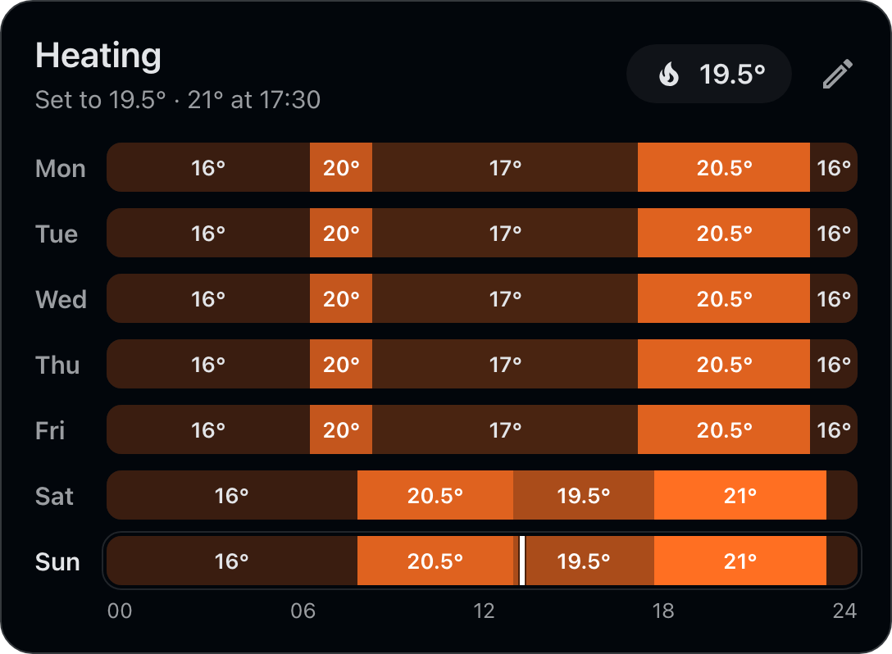
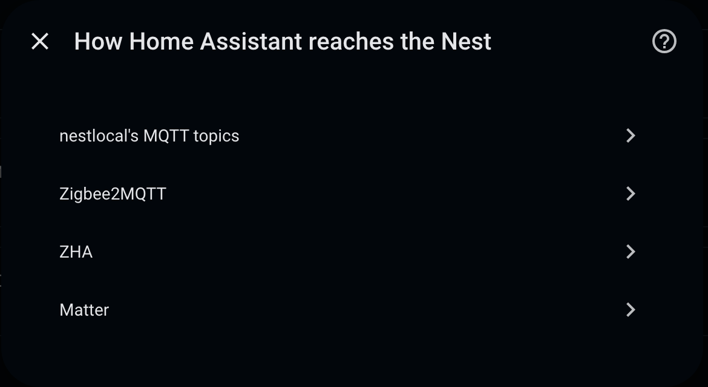
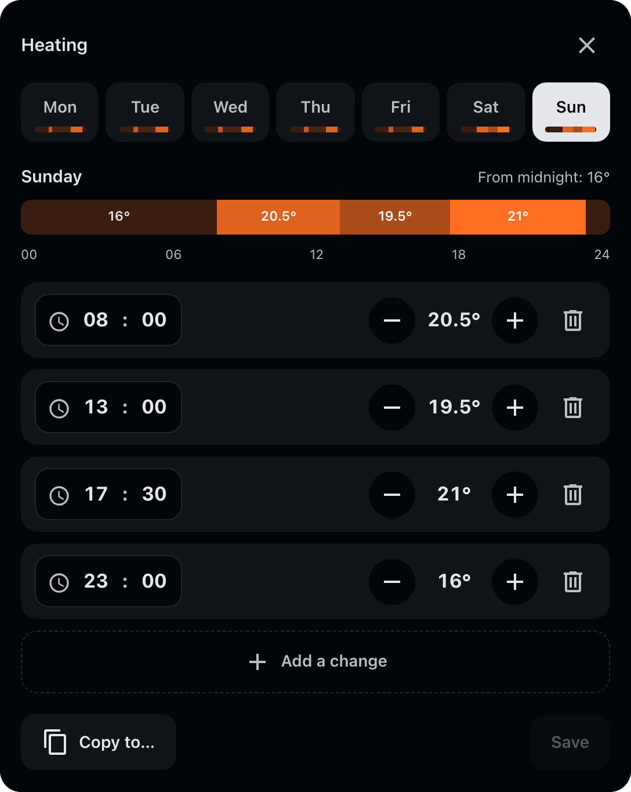
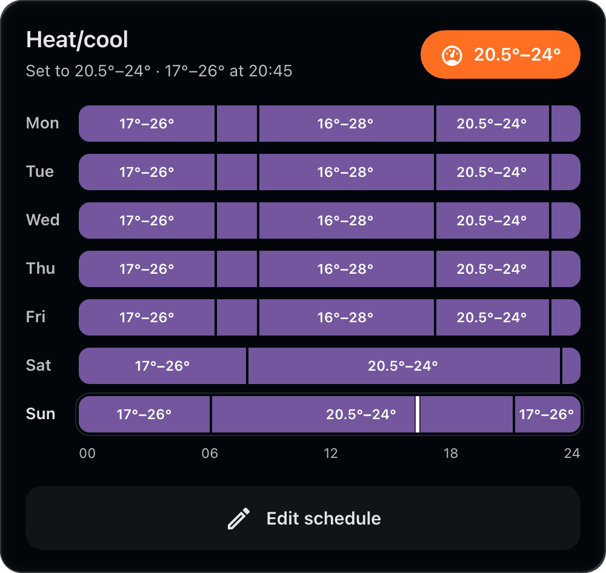
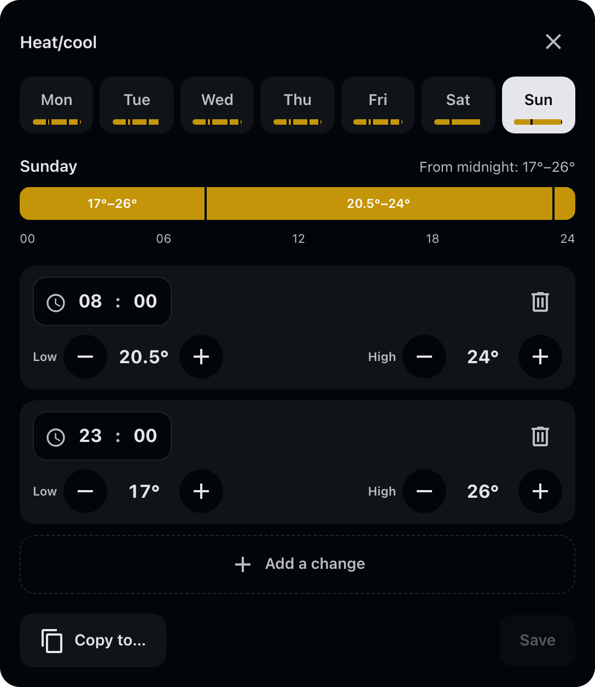

<div align="center">


# unfr0zen for Home Assistant

**Your Nest's own heating and hot water schedules, as Home Assistant calendars you can edit.**

[](https://my.home-assistant.io/redirect/marketplace_repository/?owner=unfr0zen&repository=homeassistant-unfr0zen&category=integration)
[](https://github.com/unfr0zen/homeassistant-unfr0zen/releases)
[](https://www.home-assistant.io/)
[](https://github.com/unfr0zen/homeassistant-unfr0zen/actions/workflows/validate.yml)
[](LICENSE)
[](https://buymeacoffee.com/willtm)

[](https://my.home-assistant.io/redirect/marketplace_repository/?owner=unfr0zen&repository=homeassistant-unfr0zen&category=integration)
[](https://my.home-assistant.io/redirect/config_flow_start/?domain=unfr0zen)

</div>

A Nest Learning Thermostat freed by [unfr0zen](https://github.com/unfr0zen/unfr0zen) keeps running its own weekly
schedule. This integration puts that schedule in Home Assistant, as calendars and as dashboard cards: read it, add, move
or remove a change, and the Nest takes it, over whichever way Home Assistant reaches it.

<p align="center">
  
  
</p>

## Features

- **Heating, cooling or heat-cool schedule as a calendar**, whichever the Nest runs. Each setpoint is a weekly
  event, from its time until the next one.
- **Dashboard cards** for the heating and the hot water: the whole week at a glance, edited a day at a time.
- **Edit from Home Assistant.** Create, move or delete events in the calendar panel, a card or an automation; the
  Nest takes the change and the calendar follows what the unit does.
- **Hot water schedule**, on a unit with hot water control (Heat Link), as its own calendar of on periods.
- **Every transport unfr0zen speaks:** MQTT, Zigbee2MQTT, ZHA and Matter.
- **Found on its own** when the Nest publishes over MQTT.
- **On the Nest's own device**, beside its climate and sensors; nothing in the cloud.
- **In 13 languages**, following the one you use Home Assistant in.

## Requirements

- Home Assistant 2026.10 or later.
- A Nest set up with [unfr0zen](https://github.com/unfr0zen/unfr0zen), at a release with schedules, reached over one of:

| Transport | Home Assistant needs |
|-|-|
| MQTT | the MQTT integration |
| Zigbee2MQTT | the MQTT integration, unfr0zen's converter |
| ZHA | ZHA |
| Matter (Wi-Fi or Thread) | the Matter integration |

Each carries both the heating and the hot water schedule.

## Installation

### Marketplace (recommended)

1. Click **Open in Marketplace** above: Home Assistant opens the repository in its Marketplace (**Settings →
   Marketplace**). Or add `https://github.com/unfr0zen/homeassistant-unfr0zen` to the Marketplace's **Custom
   repositories** yourself, as an **Integration**.
2. Download **unfr0zen**, then restart Home Assistant.

On Home Assistant 2026.10, which has no Marketplace, the same button opens HACS, which installs it the same way.

### Manual

Copy `custom_components/unfr0zen` into your configuration's `custom_components/` folder and restart Home Assistant.

## Setup

Click **Add integration** above, or go to **Settings → Devices & services → Add integration → unfr0zen**, and pick how
Home Assistant reaches the Nest. A Nest on MQTT shows up under **Discovered** by itself.

<p align="center">
  
</p>

Add one entry per Nest. The calendars join the Nest's existing device.

## Using the calendars

<p align="center">
  
</p>

### Heating, cooling and heat-cool

The Nest keeps a schedule for each of its modes and runs the one for the mode it is in. The heating schedule calendar
and the heating card show and change that one:

| Nest mode | Its schedule | In Home Assistant |
|-|-|-|
| Heat | heating setpoints | events titled `20.5 °C`; the card says **Heating** |
| Cool | cooling setpoints | events titled `24 °C`; the card says **Cooling**, in Home Assistant's cooling colour |
| Heat·Cool | a low and a high at each change, the Nest heating below the low and cooling above the high | events titled `19–24 °C`; the card says **Heat/cool**, in Home Assistant's purple, with a low and a high for each change |

To set cooling setpoints, switch the Nest to Cool (on the unit or its climate entity), then edit the schedule; for
heat-cool ones, Heat·Cool. Switch back and each schedule is as you left it: each mode keeps its own. The Nest takes a
few seconds to bring up another mode's schedule: edit once the card's title has changed, as a change saved before then
goes to the schedule it had.

The Nest itself runs its schedule, changing its target at each change's time: Home Assistant only reads and changes the
schedule, and the Nest keeps to it without Home Assistant. A change to the setpoint already in effect applies from its
next time.

<p align="center">
  
</p>

- Each setpoint is an event repeating every week on its day, from its time until the next setpoint, titled with its
  temperature, such as `20.5 °C`, or in heat-cool its low and high, such as `19–24 °C`.
- **Add a change:** a new event that repeats weekly with no end, at the time it should start, titled with the
  temperature (or the low and high). It may repeat on several days; its end is ignored, as the next setpoint ends it.
- **Edit or delete** one occurrence and the whole series changes: the Nest's schedule is the same every week.
- Writing the schedule turns off the Nest's Auto-Schedule, so it doesn't learn over your changes.

### Hot water

- Each on period is an event repeating every week and may run past midnight. Over Matter, touching periods appear as one event when their combined duration is under 24 hours.
- Add, move or delete periods as for heating; the title is ignored.
- The calendar only exists on a Nest with hot water control, and comes or goes with it.

### Limits

| | Heating, cooling or heat-cool | Hot water |
|-|-|-|
| Per day | 10 setpoints | 6 periods |
| Temperatures | 4.5–35 °C (9–32 °C over Zigbee and Matter), in half degrees; a heat-cool high 1.5 °C or more above its low | — |
| Refused | one-off events, other repeats, all-day events | one-off events, other repeats, all-day events, overlapping periods |

Matter supports up to 56 distinct heat-cool transitions per week. The same time, low and high on several days count once.

A refused change is reported with the reason and leaves the Nest's schedule as it was.

<details>
<summary><b>How each transport carries the schedule</b></summary>

| Transport | Heating | Hot water |
|-|-|-|
| MQTT | `<prefix>/<serial>/heating_times`, `set/heating_times` | `<prefix>/<serial>/hot_water_times`, `set/hot_water_times` |
| Zigbee2MQTT | the device's `heating_times` (Set/Get Weekly Schedule) | the device's `hot_water_times` |
| ZHA | Thermostat cluster Set/Get Weekly Schedule, one day per request | manufacturer cluster `0xFC01`, one attribute per day |
| Matter | Thermostat cluster `Schedules` (Matter 1.4), written in an atomic write | the same, on the Nest's Water Heater endpoint |

ZHA offers no action that returns a command's answer, so the ZHA backend reaches the Thermostat cluster through ZHA's
internal gateway; a Home Assistant release that changes those internals shows as an error naming the device. The full
protocol is in unfr0zen's [protocol reference](https://unfr0zen.com/protocols/).

</details>

## Dashboard cards

Two cards come with the integration, in the card picker as **unfr0zen heating** and **unfr0zen hot water**:

```yaml
type: custom:unfr0zen-heating-card
entity: calendar.nest_thermostat_heating_schedule
```

```yaml
type: custom:unfr0zen-hot-water-card
entity: calendar.nest_thermostat_hot_water_schedule
```

- **Heating** shows the week's setpoints, the one in effect and the next, and the thermostat's target, lit in Home
  Assistant's heating or cooling colour while the Nest heats or cools. In Cool it shows the cooling schedule, titled
  **Cooling**; in Heat·Cool the heat-cool one, titled **Heat/cool**, each change a low and a high.
- **Hot water** shows the week's on periods, whether hot water is on now and when it next comes on, with its boost and
  its on/off switch.
- **Edit schedule** opens a day at a time: change, add or remove setpoints or periods, copy a day to others, and save;
  the Nest takes the days changed in one write.
- **Drag on the day's bar** to change times, in steps of 15 minutes. An edge changes one time; where two slots meet,
  both follow it. The middle of a slot moves it whole, keeping its length: a hot water period only as far as the free
  time around it, a heating slot as far as its neighbours, which take up the difference, can keep 15 minutes.

<p align="center">
  
  
</p>

<p align="center">
  
  
</p>

The cards find the Nest's climate entity, hot water switch, boost and hot water sensor on its device. Set them yourself
with `climate`, `switch`, `boost`, `active` or `water_heater` if they are elsewhere.

Automations can do what the editor does with the `unfr0zen.set_schedule` and `unfr0zen.set_hot_water_schedule` actions,
which replace the days they name:

```yaml
action: unfr0zen.set_schedule
target:
  entity_id: calendar.nest_thermostat_heating_schedule
data:
  days:
    sat: [{ time: "08:00", temp: 20.5 }, { time: "23:00", temp: 16 }]
```

In heat-cool, each setpoint is a `low` and a `high` instead of a `temp`:
`sat: [{ time: "08:00", low: 20.5, high: 24 }]`.

## Languages

The integration and its cards are in English, Čeština, Dansk, Deutsch, Español, Français, Italiano, Nederlands, Norsk
bokmål, Polski, Português (Brasil), Svenska and 简体中文, in the language you use Home Assistant in; anything a
translation lacks is in English.

To add one, copy each `en.json` under a new language code, translate its values (keep the keys and the `{placeholders}`),
and add the code to `LANGUAGES` at the top of the cards' script:

- `custom_components/unfr0zen/translations/`: setup, entity names, actions and errors, as Home Assistant reads them.
- `custom_components/unfr0zen/frontend/locales/`: the cards. Day names and numbers come from the browser.

## Development

```sh
uv venv -p python3.14 .venv
uv pip install -p .venv -r requirements_test.txt
.venv/bin/python -m pytest
.venv/bin/ruff format --check . && .venv/bin/ruff check .
```

## License

[GPL-3.0-or-later](LICENSE), as unfr0zen.
